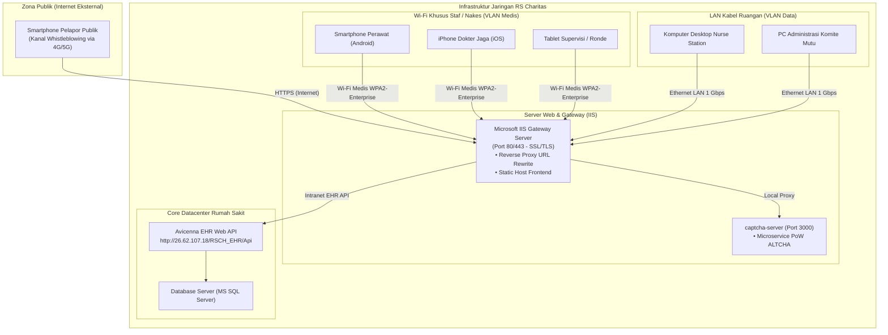

# PETUNJUK TEKNIS (JUKNIS)
# SISTEM PELAPORAN INSIDEN (AVICENNA INCIDENT REPORT)
### DOKUMENTASI TEKNIS & ARSITEKTUR UNTUK TIM TEKNOLOGI INFORMASI (IT) RUMAH SAKIT
**Rumah Sakit Charitas / Avicenna Healthcare Solution**  
*Versi Dokumen: 2.2 — Klasifikasi: Dokumen Teknis Arsitektur & Operasional IT*

---

## DAFTAR ISI
1. [Deskripsi Sistem & Paradigma Mobile-First Cross-Device](#1-deskripsi-sistem--paradigma-mobile-first-cross-device)
2. [Arsitektur Desain Responsif & Kompatibilitas Perangkat](#2-arsitektur-desain-responsif--kompatibilitas-perangkat)
   - 2.1. [Filosofi Mobile-First & Pengoperasian Point-of-Care](#21-filosofi-mobile-first--pengoperasian-point-of-care)
   - 2.2. [Mekanisme Deteksi Perangkat (`src/utils/useDeviceInfo.ts`)](#22-mekanisme-deteksi-perangkat-srcutilsusedeviceinfots)
   - 2.3. [Integrasi Kamera Smartphone & HTML5 Media Capture API](#23-integrasi-kamera-smartphone--html5-media-capture-api)
   - 2.4. [Dukungan Layar Lebar (PC / Laptop Nurse Station)](#24-dukungan-layar-lebar-pc--laptop-nurse-station)
3. [Spesifikasi Infrastruktur & Jaringan Rumah Sakit](#3-spesifikasi-infrastruktur--jaringan-rumah-sakit)
   - 3.1. [Topologi Jaringan (Intranet Wi-Fi Medis vs DMZ Publik)](#31-topologi-jaringan-intranet-wi-fi-medis-vs-dmz-publik)
   - 3.2. [Kebutuhan Perangkat Keras Minimum (Server & Client Hardware)](#32-kebutuhan-perangkat-keras-minimum-server--client-hardware)
   - 3.3. [Kebutuhan Perangkat Lunak & Runtime Environment](#33-kebutuhan-perangkat-lunak--runtime-environment)
4. [Arsitektur Perangkat Lunak & Struktur Kode](#4-arsitektur-perangkat-lunak--struktur-kode)
   - 4.1. [Tumpukan Teknologi Frontend](#41-tumpukan-teknologi-frontend)
   - 4.2. [Struktur Direktori Modular (`src/`)](#42-struktur-direktori-modular-src)
   - 4.3. [State Management, Form Handling & Validasi](#43-state-management-form-handling--validasi)
5. [Integrasi Layanan Backend & Antarmuka API](#5-integrasi-layanan-backend--antarmuka-api)
   - 5.1. [Integrasi SIMRS EHR API (`RSCH_EHR`)](#51-integrasi-simrs-ehr-api-rsch_ehr)
   - 5.2. [Protokol Otentikasi & Header Khusus EHR](#52-protokol-otentikasi--header-khusus-ehr)
   - 5.3. [Integrasi Microservice `captcha-server`](#53-integrasi-microservice-captcha-server)
   - 5.4. [Alur Kriptografi Proof-of-Work (PoW) ALTCHA](#54-alur-kriptografi-proof-of-work-pow-altcha)
6. [Konfigurasi Variabel Lingkungan (`.env`)](#6-konfigurasi-variabel-lingkungan-env)
7. [Mekanisme Keamanan Sistem](#7-mekanisme-keamanan-sistem)
   - 7.1. [Enkripsi Sesi LocalStorage (AES-256)](#71-enkripsi-sesi-localstorage-aes-256)
   - 7.2. [Pencegahan Serangan Replay (Anti-Replay Store)](#72-pencegahan-serangan-replay-anti-replay-store)
   - 7.3. [Validasi & Konversi Berkas Bukti (Base64 Pipeline)](#73-validasi--konversi-berkas-bukti-base64-pipeline)
8. [Panduan Build & Penerapan Produksi (IIS Windows Server)](#8-panduan-build--penerapan-produksi-iis-windows-server)
   - 8.1. [Kompilasi Frontend (Vite Production Build)](#81-kompilasi-frontend-vite-production-build)
   - 8.2. [Penerapan pada Internet Information Services (IIS)](#82-penerapan-pada-internet-information-services-iis)
   - 8.3. [Konfigurasi IIS Reverse Proxy & URL Rewrite](#83-konfigurasi-iis-reverse-proxy--url-rewrite)
   - 8.4. [Konfigurasi Layanan Windows untuk `captcha-server`](#84-konfigurasi-layanan-windows-untuk-captcha-server)
9. [Pemeliharaan, Logging & Health Monitoring](#9-pemeliharaan-logging--health-monitoring)
10. [Matriks Troubleshooting Teknis IT](#10-matriks-troubleshooting-teknis-it)

---

## 1. Deskripsi Sistem & Paradigma Mobile-First Cross-Device

Aplikasi **Avicenna Incident Report** adalah sistem pelaporan insiden terpadu berbasis web SPA (*Single Page Application*) yang dibangun dengan **pendekatan arsitektur Mobile-First (dioptimalkan secara khusus untuk pengalaman penggunaan pada ponsel pintar/smartphone nakes)** namun tetap **sepenuhnya kompatibel, responsif, dan adaptif untuk dibuka pada peramban web di perangkat keras (hardware) apa saja** (seperti komputer meja/PC Nurse Station, laptop administrasi, hingga tablet dokter).

### Alasan Arsitektur Mobile-First:
1. **Mobilitas Tenaga Kesehatan**: Dokter dan perawat memiliki mobilitas tinggi di ruang rawat inap (*ward*), poliklinik, dan IGD. Pelaporan insiden paling efektif dilakukan seketika di lokasi kejadian (*Point-of-Care*) sebelum detail insiden terlupakan.
2. **Kamera Fisik Terintegrasi**: Perangkat mobile memungkinkan staf memotret langsung kondisi fisik luka, tumpahan bahan kimia berbahaya, atau kerusakan alat medis tanpa perlu memindahkan file manual dari kamera terpisah ke komputer.
3. **Mengurangi Beban Komputer Nurse Station**: PC Nurse Station sering kali mengalami antrean pemakaian untuk entri resep elektronik (*E-Prescribing*) dan rekam medis pasien. Akses melalui smartphone staf membebaskan beban antrean tersebut.
4. **Fleksibilitas Lintas Platform (*Cross-Platform*)**: Tidak memerlukan instalasi aplikasi via Google Play Store / Apple App Store yang membutuhkan sertifikat enterprise rumit; cukup diakses via browser modern standar.

---

## 2. Arsitektur Desain Responsif & Kompatibilitas Perangkat

### 2.1. Filosofi Mobile-First & Pengoperasian Point-of-Care
Antarmuka pengguna (UI) dirancang dengan tata letak satu kolom vertikal (*single-column flow*), tombol sentuh berukuran minimal 44×44 piksel (standar aksesibilitas mobile WCAG), input compact (`size="xs"`), dan struktur kartu vertikal yang ergonomis untuk pengoperasian satu tangan (*thumb-friendly navigation*).

### 2.2. Mekanisme Deteksi Perangkat (`src/utils/useDeviceInfo.ts`)
Frontend menggunakan hook reaktif kustom `useDeviceInfo()` yang memantau ukuran *viewport* dan orientasi perangkat secara dinamis:

```typescript
// Breakpoints Responsif pada useDeviceInfo.ts
const MIN_WIDTH = {
  MOBILE: "(min-width: 320px)",
  SMALL: "(min-width: 481px)",
  MEDIUM: "(min-width: 769px)",
  LARGE: "(min-width: 1025px)",
} as const;

// Klasifikasi Tipe Perangkat
type DeviceType = "MOBILE" | "TABLET" | "LAPTOP" | "DESKTOP" | "UNRECOGNIZED";
```

- **Layar Smartphone (320px – 480px)**:
  - Lebar form otomatis disetel ke `w={info.size.width * 0.9}` atau `90vw`.
  - Bilah samping navigasi (*AppShell Navbar*) otomatis disembunyikan (*collapsed*) di balik tombol burger (*Burger Menu*).
  - Kolom input grid bertingkat disesuaikan menjadi aliran vertikal untuk mencegah *horizontal scrolling*.
- **Layar Tablet & Desktop (> 768px)**:
  - Form berada di dalam container terpusat (`Container size="xs"` atau `size="sm"`) dengan batas lebar maksimum (*max-width*) agar tidak melebar berlebihan (*stretched*).
  - Navbar desktop tampil permanen di sisi kiri untuk mempermudah navigasi mouse.

### 2.3. Integrasi Kamera Smartphone & HTML5 Media Capture API
Modul pengunggahan bukti (`Dropzone` pada Mantine) dioptimalkan untuk perangkat bergerak:
- Ketika pengguna smartphone menyentuh area dropzone bukti, peramban mobile secara otomatis memicu antarmuka sistem operasi untuk memilih **Kamera Langsung (*Take Photo*)** atau **Penyimpanan Berkas/Galeri**.
- Gambar yang ditangkap dikonversi secara asinkron menjadi Base64 melalui `FileReader API` di dalam thread klien sebelum dikirim ke endpoint `EvidenceUploadBase64`.

### 2.4. Dukungan Layar Lebar (PC / Laptop Nurse Station)
Meskipun berorientasi mobile, aplikasi tetap berjalan sempurna pada komputer meja (PC) dengan sistem operasi Windows, macOS, maupun Linux. Pengguna desktop mendapatkan keuntungan navigasi keyboard fisik, input teks kronologi yang leluasa, serta kemampuan drag-and-drop dokumen dari File Explorer.

---

## 3. Spesifikasi Infrastruktur & Jaringan Rumah Sakit

### 3.1. Topologi Jaringan (Intranet Wi-Fi Medis vs DMZ Publik)



### 3.2. Kebutuhan Perangkat Keras Minimum (Server & Client Hardware)

| Kategori | Komponen | Spesifikasi Minimum | Rekomendasi |
| :--- | :--- | :--- | :--- |
| **Client: Smartphone (HP)** | RAM | 2 GB | 4 GB+ (Android 10+ / iOS 14+) |
| | Peramban | Chrome Mobile 90+, Safari iOS 14+ | Versi terbaru |
| | Kamera | 5 Megapixel (dukungan fokus dekat) | Kamera bawaan smartphone |
| **Client: Desktop / PC** | RAM | 4 GB | 8 GB (Windows 10/11) |
| | Peramban | Google Chrome, Edge, Firefox | Resolusi 1366×768 s/d 1920×1080 |
| **Server: IIS Web Server** | CPU / RAM | 4 Core vCPU / 8 GB RAM | 8 Core vCPU / 16 GB RAM |
| | Storage | 50 GB SSD | 100 GB NVMe SSD |

### 3.3. Kebutuhan Perangkat Lunak & Runtime Environment
- **Server Web**: Windows Server 2019 / 2022 dengan IIS 10.0+.
- **Modul Ekstensi IIS**:
  - *URL Rewrite 2.1* (Penanganan rute SPA & Reverse Proxy).
  - *Application Request Routing (ARR) 3.0*.
- **Runtime Microservice**: Node.js v20.x atau v22.x LTS.

---

## 4. Arsitektur Perangkat Lunak & Struktur Kode

### 4.1. Teknologi Frontend
- **Framework**: React v19.2.0 (Single Page Application).
- **Bahasa**: TypeScript v5.9.3.
- **Bundler & Build Tool**: Vite v7.3.1.
- **Komponen UI**: Mantine UI v8.3.16.
- **Manajemen Kueri Server**: TanStack React Query v5.90.21.
- **Otentikasi & Keamanan Sesi**: CryptoJS v4.2.0 (AES-256).
- **Widget Keamanan Anti-Bot**: ALTCHA Web Component (`<altcha-widget>`).

### 4.2. Struktur Direktori Modular (`src/`)

```
src/
├── components/                      # Komponen antarmuka global
│   ├── captcha/                     # Modul integrasi ALTCHA CAPTCHA
│   │   ├── AltchaWidget.tsx         # Komponen React pembungkus <altcha-widget>
│   │   └── index.ts                 # Ekspor komponen & tipe AltchaWidgetRef
│   ├── confirmModal/                # Modal dialog konfirmasi submit Mantine
│   ├── incidentListCard/            # Kartu item insiden tampilan mobile
│   ├── incidentListPageCard/        # Container filter dan list kartu
│   └── privateRoutes/               # Auth guard proteksi rute internal
├── config/                          # Konfigurasi routing & Axios
│   ├── appRoute.ts                  # Hook navigasi custom
│   ├── axios.ts                     # Axios client + interceptor SIMRS
│   └── routes/                      # Definisi rute publik dan protected
├── features/                        # Modul berbasis fitur bisnis
│   ├── employeeIncident/            # Modul K3RS (4 tipe insiden kerja)
│   ├── home/                        # Halaman dashboard utama
│   ├── login/                       # Modul login karyawan
│   ├── nonConformitySafetyCulture/  # Modul budaya keselamatan (NCSF)
│   ├── patientIncident/             # Modul insiden keselamatan pasien (IKP)
│   └── whistleblowing/              # Modul pengaduan anonim publik
├── services/                        # Service layer non-EHR
│   └── captcha.service.ts           # Layanan verifikasi POST /verify
├── types/                           # Deklarasi tipe TypeScript global (*.d.ts)
│   └── altcha.d.ts                  # Deklarasi tipe JSX <altcha-widget>
└── utils/                           # Utilitas logika (useDeviceInfo, AES, Base64)
```

---

## 5. Integrasi Layanan Backend & Antarmuka API

### 5.1. Integrasi SIMRS EHR API
Frontend berkomunikasi dengan modul Incident Report SIMRS melalui endpoint REST/JSON di `{base}/Api/IncidentReport/`:

| Endpoint API SIMRS | Metode | Deskripsi Fungsi |
| :--- | :---: | :--- |
| `Login` | POST | Verifikasi UserID & Password pegawai |
| `RegistrationGetList` | POST | Pencarian data pasien aktif (No Registrasi/Nama) |
| `PersonalGetList` | POST | Pencarian pegawai rumah sakit & staf alih daya |
| `PositionGetList` | POST | Mengambil data master jabatan SIMRS |
| `ServiceUnitGetList` | POST | Mengambil master unit/ruangan/instalasi kerja |
| `StandardReferenceGetList` | POST | Mengambil master kode referensi baku |
| `RiskGradingGetList` | POST | Mengambil master derajat risiko klinis & warna |
| `RiskGradingMtxGet` | POST | Menghitung otomatis matriks keparahan x frekuensi |
| `PatientIncidentSet` | POST | Menyimpan transaksi insiden pasien (IKP) |
| `PatientIncidentApprove`| PUT | Eskalasi persetujuan insiden pasien ke Komite Mutu |
| `EmployeeIncidentSet` | POST | Menyimpan transaksi insiden kecelakaan kerja K3RS |
| `EmployeeIncidentApprove`| PUT| Eskalasi approval insiden K3RS |
| `EmployeeNonConformitySafetyCultureSet` | POST | Menyimpan transaksi ketidaksesuaian budaya (NCSF) |
| `EmployeeNonConformitySafetyCultureApprove`| PUT| Eskalasi approval laporan NCSF |
| `WhistleblowingSet` | POST | Mendaftarkan laporan pengaduan pelanggaran |
| `WhistleblowingApprove` | PUT | Mengunci & mengeskalasi laporan WBS |
| `EvidenceUploadBase64` | POST | Mengunggah dokumen/foto bukti dalam format Base64 |

### 5.2. Protokol Otentikasi & Header Khusus EHR
Setiap pemanggilan API SIMRS EHR diatur melalui Axios Request Interceptor (`src/config/axios.ts`):
```http
X-UserID: <ID_Pengguna_Login_atau_anonym>
AccessKey: abcd1234
Encrypted: {{encrypted}}
EncryptionMethod: des
Content-Type: application/json
```

### 5.3. Integrasi Microservice `captcha-server`
- **GET `/challenge`**: Mengembalikan objek tantangan Proof-of-Work (PBKDF2/SHA-256).
- **POST `/verify`**: Menerima payload solusi `{ payload: "..." }` dan mengembalikan status keabsahan.

---

## 6. Konfigurasi Variabel Lingkungan (`.env`)

```ini
# ===================================================================
# KONFIGURASI API BACKEND SIMRS EHR (RUMAH SAKIT CHARITAS)
# ===================================================================
VITE_API_BASE_URL=
VITE_API_BASE_URL_MOBILE2=

VITE_API_ACCESS_KEY=
VITE_API_ENC_METHOD=
VITE_API_ACCESSKEY=
VITE_API_ACCESSKEY_WHISTLEBLOWING=
VITE_API_SCI_ACCESSKEY=
VITE_SECRET_KEY=

# ===================================================================
# KONFIGURASI MICROSERVICE CAPTCHA MANDIRI (captcha-server)
# ===================================================================
VITE_CAPTCHA_URL=
VITE_CAPTCHA_VERIFY_URL=
```

---

## 7. Mekanisme Keamanan Sistem

### 7.1. Enkripsi Sesi LocalStorage (AES-256)
- Data otentikasi disimpan di `localStorage` peramban klien dalam bentuk *ciphertext* terenkripsi AES (`src/utils/encryptDecrypt.ts`).
- Masa berlaku sesi dibatasi 6 hari (`expiredDate`). Saat waktu terlampaui, sistem otomatis menghapus sesi dan mengalihkan layar ke `/login`.

### 7.2. Pencegahan Serangan Replay (Anti-Replay Store)
- `captcha-server` menggunakan cache memori `CappedMap` untuk menyimpan token solusi yang telah dipakai. Solusi yang dikirim ulang akan ditolak dengan pesan *Replay attack detected*.

### 7.3. Validasi & Konversi Berkas Bukti (Base64 Pipeline)
- Berkas gambar/dokumen yang diunggah melalui ponsel dikonversi menjadi format Base64 di sisi klien dan dikirimkan secara asinkron dengan asosiasi `TransactionNo`.

---

## 8. Panduan Build & Penerapan Produksi (IIS Windows Server)

### 8.1. Kompilasi Frontend (Vite Production Build)
```bash
npm install
npm run build
```
Hasil berkas teroptimasi berada di direktori `dist/`.

### 8.2. Penerapan pada IIS & Aturan Routing SPA (`web.config`)
Simpan berkas `web.config` di dalam folder `dist/` untuk memastikan URL SPA tidak menyebabkan error 404 saat pengguna melakukan *refresh* di ponsel:

```xml
<?xml version="1.0" encoding="UTF-8"?>
<configuration>
  <system.webServer>
    <rewrite>
      <rules>
        <rule name="SPA Fallback Routing" stopProcessing="true">
          <match url=".*" />
          <conditions logicalGrouping="MatchAll">
            <add input="{REQUEST_FILENAME}" matchType="IsFile" negate="true" />
            <add input="{REQUEST_FILENAME}" matchType="IsDirectory" negate="true" />
            <add input="{REQUEST_URI}" pattern="^/(api)" negate="true" />
            <add input="{REQUEST_URI}" pattern="^/(altcha)" negate="true" />
          </conditions>
          <action type="Rewrite" url="/" />
        </rule>
      </rules>
    </rewrite>
    <staticContent>
      <mimeMap fileExtension=".webp" mimeType="image/webp" />
    </staticContent>
  </system.webServer>
</configuration>
```

### 8.3. Konfigurasi Layanan Windows untuk `captcha-server`
Daftarkan `captcha-server` sebagai Layanan Windows via NSSM:
```cmd
nssm install CaptchaServerService "C:\Program Files\nodejs\node.exe" "D:\Services\captcha-server\dist\index.js"
nssm set CaptchaServerService AppDirectory "D:\Services\captcha-server"
nssm set CaptchaServerService Start SERVICE_AUTO_START
nssm start CaptchaServerService
```

---

## 9. Pemeliharaan, Logging & Health Monitoring

- **Health Check Microservice**: Buka `GET /health` untuk memantau status uptime dan jumlah token anti-replay.
- **Log IIS**: Terletak di `C:\inetpub\logs\LogFiles\W3SVC*`.

---

## 10. Matriks Troubleshooting Teknis IT

| Gejala Error | Kemungkinan Penyebab | Tindakan Solusi Teknis |
| :--- | :--- | :--- |
| **Kamera HP Tidak Membuka Saat Upload Bukti** | Browser mobile belum diberi izin kamera (*Permission Denied*). | Pandu staf untuk mengaktifkan izin Kamera di Pengaturan Browser smartphone (Chrome/Safari). |
| **Tampilan Form Terpotong di Layar HP Tertentu** | Ukuran viewport ekstrim (< 320px) atau browser zoom aktif. | Komponen telah diuji pada lebar 320px+. Pastikan pengaturan zoom teks di browser HP disetel ke 100%. |
| **HTTP 502.3 Bad Gateway pada CAPTCHA** | Service `captcha-server` di port 3000 mati. | Lakukan *Restart Service* pada Windows Service `CaptchaServerService`. |
| **CORS Policy Error di Browser Mobile** | Domain atau IP asal Wi-Fi belum masuk daftar `CORS_ORIGIN`. | Periksa berkas `.env` pada `captcha-server`, setel `CORS_ORIGIN=*` untuk pengujian atau cantumkan domain resmi. |
| **404 Not Found saat Refresh Halaman di HP** | Modul IIS URL Rewrite belum terpasang atau berkas `web.config` hilang. | Pasang modul *IIS URL Rewrite 2.1* dan pastikan berkas `web.config` ada di folder root situs. |
| **Sesi Login Sering Logout Sendiri** | Beda waktu antara server web dan domain controller (*Time Drift*). | Sinkronkan waktu Windows Server dengan NTP server rumah sakit. |
